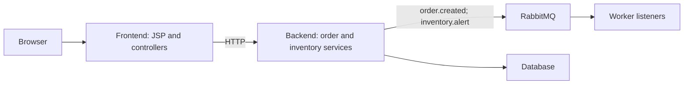

# Guideline alignment: potential changes

## Executive summary

The root `guideline.md` applies to the backend, frontend and worker and sets Java 21+ as the target, not a description of their current Java 8 snapshots.[^guideline] The three application snapshots target Java 8 and have no tracked tests or CI workflows; their actual deployed configuration, external CI and measured coverage were not verified.[^builds][^frontend-build][^worker-build] Priority changes are to protect credentials, establish a compatible Java 21 build and runtime, add deterministic JUnit 5 tests with a per-project 75% unit-only line coverage gate, and add merge-blocking browser tests.[^guideline][^testing][^credentials] Application changes should address boundary validation, concealed failures, safe logging and dependency injection; the frontend's visible approval link has no corresponding frontend handler.[^coding][^backend-errors][^frontend-approval] Repair the guideline's broken local architecture link and keep existing-state documentation distinct from the target.[^guideline][^docs-tree]

## Scope and evidence

This assessment treats the Fusion repository's root `guideline.md` as authoritative for this request. The snapshots are immutable source revisions, not a statement about deployed state:

| Repository | Reviewed revision | Role |
|---|---|---|
| [luxu-ms/SupplyChain-Docs-Fusion](https://github.com/luxu-ms/SupplyChain-Docs-Fusion) | `3e81b3187da918290bd8b378c39bdfd6942e9ca2` | Guideline and source research[^guideline] |
| [luxu-ms/SupplyChain-Backend](https://github.com/luxu-ms/SupplyChain-Backend) | `a21f57e84901bad3cf315de2a3520fa8fe34b911` | Order, inventory and vendor services[^backend-orders] |
| [luxu-ms/SupplyChain-Frontend](https://github.com/luxu-ms/SupplyChain-Frontend) | `c613adbc961e0499d8f2ddb3e087ade7a9a40881` | Server-rendered web application[^frontend-routes] |
| [luxu-ms/SupplyChain-Worker](https://github.com/luxu-ms/SupplyChain-Worker) | `458f2bab94b08b3acd167feb04fc485a7ecf6133` | Queue listeners and simulated notifications[^worker-listener] |

The diagram represents intended code paths, not verified end-to-end delivery. The `inventory.alert` publisher has no caller or scheduler found in the pinned backend; no producer for `approval.pending` was found. Worker notifications are simulated.[^integration][^worker-listener]

## Recommended changes

### 1. Establish the Java 21+ baseline

All three Maven projects specify Java 8 and their Docker build and runtime stages use Java 8; the image builds skip tests.[^builds][^frontend-build][^worker-build] In each repository:

1. Set the Maven compiler `release` to the chosen supported Java version, at least 21, rather than relying on Java 8 `source`/`target`.
2. Align developer builds, CI, Docker build images and runtime images. Run tests in a separate required CI step rather than relying on the test-skipping image build.
3. Verify Spring Boot, dependencies, Lombok, database driver, servlet container and JSP compatibility as applicable. If selecting Spring Boot 3, account for the `javax` to `jakarta` migration; do not assume that a specific framework version upgrade is required by this guideline.[^guideline][^backend-jakarta]

### 2. Add measurable test and merge gates

The pinned trees contain no tracked test sources or CI workflows, and their POMs do not configure a JaCoCo coverage gate. This is a repository observation, not proof that external CI is absent or that a particular coverage percentage was measured.[^builds][^frontend-build][^worker-build]

- For **each** Java project, add focused JUnit 5 tests for business rules, boundaries and expected failures, with mocked external services and regression tests for bug fixes. Configure JaCoCo or an equivalent to measure production **line** coverage from unit tests and fail CI below **75%**. Report integration and UI coverage separately; do not count them toward the threshold or exclude business logic to pass.[^testing]
- Add frontend browser tests to pull-request CI and require their success before merge. Exercise dashboard loading, valid order submission, validation feedback, and the submitted order appearing in pending. Inventory browsing and approval are conditional on the corresponding UI flow being available. Use isolated data, stable selectors, condition-based waits, visible assertions and failure traces or screenshots.[^ui-testing]
- Configure the repository's actual branch protection or rulesets so failed required checks block merge; verify the existing external CI and policy before declaring compliance. Browser tests should run against a controlled test environment rather than live shared data.[^ui-testing]

### 3. Backend: validation, failures and security

- Replace direct binding of the persistence entity with a validated create request; validate required fields, amount precision and scale, and vendor inputs. Compare monetary values with `BigDecimal.ZERO` and define an explicit rounding or rejection policy rather than converting to `double`. The database mapping declares scale 2, while the current positivity check can accept a value such as `0.001`; database handling was not tested.[^backend-validation]
- Set status and approval fields on the server rather than accepting them through the create request. Authenticate and authorize approval and derive the approver from trusted context; external gateway controls were not inspected.[^backend-approval]
- Replace field injection and wildcard imports with constructor injection and explicit imports, and apply a consistent formatter.[^backend-style][^coding]
- Do not return a genuine-looking `0.0` rating after an exception or return a successful order while silently losing a publish failure. Map expected errors to meaningful responses and preserve actionable failure context without exposing sensitive data.[^backend-errors] An outbox with retry and idempotency is one possible design for reliable order events, not a guideline-mandated technology; select and test the required delivery semantics first.
- Remove committed database and broker credentials from checked-in configuration, inject them from approved secret storage, and rotate any credentials actually used in deployed environments. Review SQL/debug logging and supplied identities for sensitivity; deployed overrides are unknown.[^credentials][^backend-logging]

### 4. Frontend: usable validation and browser journeys

- Use a restricted form model with server-side validation and visible field feedback; the current controller binds a DTO including status and approval fields without `@Valid` or `BindingResult`, while browser-only `required` constraints can be bypassed.[^frontend-form] Validate independently in the backend.
- The pending page exposes an approval link, but the frontend controller has no matching handler and the backend approval endpoint is a PUT requiring `approvedBy`.[^frontend-approval] Implement an authorized, CSRF-protected state-changing flow with error feedback, or remove the misleading action until it is available. Test approval once the flow is available; the guideline does not require inventing an otherwise absent approval feature.[^ui-testing]
- Escape untrusted values in the appropriate HTML or attribute context, encode URL components, and avoid rendering raw exception details. Values are currently interpolated directly into JSP output and form fields.[^frontend-output]
- Replace broad dashboard failure handling that displays zero counts with explicit unavailable/error states, preserving successful results where appropriate. Set explicit downstream connection and read timeouts and handle expected failures.[^frontend-errors]
- Replace field injection and wildcard imports with constructor injection and explicit imports. The form hardcodes vendor IDs despite an existing vendor client; populate valid choices from the backend and preserve them when validation fails.[^frontend-style]

### 5. Worker and messaging: visible, testable failures

- Validate incoming messages and delegate processing from thin listeners to constructor-injected services. Do not log full payloads when they may contain sensitive data; log safe metadata instead. The current listeners accept strings, log payloads and simulate notification handling.[^worker-listener]
- Stop swallowing processing failures; preserve interruption and configure and test bounded retries, dead-letter handling and idempotency as appropriate. Under the Spring AMQP default `AUTO` acknowledgment mode, a normally returning handler is treated as successful; actual broker settings and deployment overrides remain unknown.[^worker-failure] Test invalid messages, transient failures and retries without timing sleeps or shared state.[^testing]
- Define and test the producer/consumer event contract and timestamp serialization. Existing research reports a focused reproduction in which the checked-in JSON converter is expected to reject order `LocalDateTime` fields; this was not a live database-and-broker test. Publishing is attempted within the database transaction and exceptions are caught, so code does not establish atomic order/event delivery.[^serialization][^backend-orders] Queue names match in checked-in configuration; do not claim a routing mismatch or working delivery without a broker-level test.[^integration]
- Move the worker's checked-in RabbitMQ credentials to approved secret storage and rotate any that are in use.[^worker-credentials]

### 6. Documentation

The Fusion guideline links to a local `architecture.md`, but the pinned Fusion tree has no such file. Repair the link to the intended architecture document or provide an appropriate local document; clearly label the Java 8 description as a historical snapshot and Java 21+ as the target.[^guideline][^docs-tree] A separate Docs repository contains a different guideline with additional technology prescriptions; establish policy ownership rather than silently treating those extra provisions as requirements of the Fusion guideline.[^other-policy]

## Suggested sequencing

1. Remove exposed configuration credentials and assess rotation; agree on source of truth for policy and actual CI/branch protection.[^credentials][^worker-credentials][^other-policy]
2. Establish Java 21-compatible builds and runtime, add CI and initial deterministic tests, and configure separate unit and browser reporting. Reach and enforce the **75% unit-only** threshold in each Java project before calling the testing requirement complete.[^guideline][^testing][^ui-testing]
3. Fix validation, error reporting, event serialization and retry behavior with regression tests; make frontend failures and validation visible.[^backend-validation][^backend-errors][^frontend-form][^serialization]
4. Complete mandatory browser journeys and, where available, inventory and approval journeys; make the checks required and update documentation to reflect verified behavior.[^ui-testing][^frontend-approval]

## Confidence assessment

**High:** The guideline requirements, Java 8 build/image settings, checked-in configuration, source-level error handling, missing frontend approval handler, and absence of tracked tests and CI files in the examined trees are supported by the pinned sources. The assessment assumes the Fusion guideline governs the three listed application repositories, as it states.[^guideline]

**Limited:** No build, test suite, live browser journey, database, broker, deployment configuration, external CI or branch protection was independently exercised. Actual coverage, deployed secrets, message delivery and acknowledgment outcomes are therefore unknown. Timestamp serialization is supported by a previously documented focused reproduction, not a new end-to-end verification.[^serialization] Compatibility changes and delivery mechanisms are recommendations to validate, not guaranteed migrations or requirements for a particular vendor or framework.

## Footnotes

[^guideline]: [guideline.md:3-7](https://github.com/luxu-ms/SupplyChain-Docs-Fusion/blob/3e81b3187da918290bd8b378c39bdfd6942e9ca2/guideline.md#L3-L7).
[^coding]: [guideline.md:11-18](https://github.com/luxu-ms/SupplyChain-Docs-Fusion/blob/3e81b3187da918290bd8b378c39bdfd6942e9ca2/guideline.md#L11-L18).
[^testing]: [guideline.md:20-24](https://github.com/luxu-ms/SupplyChain-Docs-Fusion/blob/3e81b3187da918290bd8b378c39bdfd6942e9ca2/guideline.md#L20-L24).
[^ui-testing]: [guideline.md:26-30](https://github.com/luxu-ms/SupplyChain-Docs-Fusion/blob/3e81b3187da918290bd8b378c39bdfd6942e9ca2/guideline.md#L26-L30).
[^docs-tree]: [Fusion tree at reviewed commit](https://github.com/luxu-ms/SupplyChain-Docs-Fusion/tree/3e81b3187da918290bd8b378c39bdfd6942e9ca2).
[^builds]: [Backend pom.xml:16-28](https://github.com/luxu-ms/SupplyChain-Backend/blob/a21f57e84901bad3cf315de2a3520fa8fe34b911/pom.xml#L16-L28); [Dockerfile:6-16](https://github.com/luxu-ms/SupplyChain-Backend/blob/a21f57e84901bad3cf315de2a3520fa8fe34b911/Dockerfile#L6-L16); [backend tree](https://github.com/luxu-ms/SupplyChain-Backend/tree/a21f57e84901bad3cf315de2a3520fa8fe34b911).
[^frontend-build]: [Frontend pom.xml:16-28](https://github.com/luxu-ms/SupplyChain-Frontend/blob/c613adbc961e0499d8f2ddb3e087ade7a9a40881/pom.xml#L16-L28); [Dockerfile:1-18](https://github.com/luxu-ms/SupplyChain-Frontend/blob/c613adbc961e0499d8f2ddb3e087ade7a9a40881/Dockerfile#L1-L18); [frontend tree](https://github.com/luxu-ms/SupplyChain-Frontend/tree/c613adbc961e0499d8f2ddb3e087ade7a9a40881).
[^worker-build]: [Worker pom.xml:16-28](https://github.com/luxu-ms/SupplyChain-Worker/blob/458f2bab94b08b3acd167feb04fc485a7ecf6133/pom.xml#L16-L28); [Dockerfile:1-18](https://github.com/luxu-ms/SupplyChain-Worker/blob/458f2bab94b08b3acd167feb04fc485a7ecf6133/Dockerfile#L1-L18); [worker tree](https://github.com/luxu-ms/SupplyChain-Worker/tree/458f2bab94b08b3acd167feb04fc485a7ecf6133).
[^backend-jakarta]: [Backend PurchaseOrder.java:3-15](https://github.com/luxu-ms/SupplyChain-Backend/blob/a21f57e84901bad3cf315de2a3520fa8fe34b911/src/main/java/com/acme/scm/model/PurchaseOrder.java#L3-L15).
[^backend-orders]: [Backend PurchaseOrderService.java:33-61](https://github.com/luxu-ms/SupplyChain-Backend/blob/a21f57e84901bad3cf315de2a3520fa8fe34b911/src/main/java/com/acme/scm/service/PurchaseOrderService.java#L33-L61).
[^backend-validation]: [Backend PurchaseOrderController.java:43-47](https://github.com/luxu-ms/SupplyChain-Backend/blob/a21f57e84901bad3cf315de2a3520fa8fe34b911/src/main/java/com/acme/scm/controller/PurchaseOrderController.java#L43-L47); [PurchaseOrderService.java:36-48](https://github.com/luxu-ms/SupplyChain-Backend/blob/a21f57e84901bad3cf315de2a3520fa8fe34b911/src/main/java/com/acme/scm/service/PurchaseOrderService.java#L36-L48); [PurchaseOrder.java:22-33](https://github.com/luxu-ms/SupplyChain-Backend/blob/a21f57e84901bad3cf315de2a3520fa8fe34b911/src/main/java/com/acme/scm/model/PurchaseOrder.java#L22-L33).
[^backend-approval]: [Backend PurchaseOrder.java:18-45, 56-62](https://github.com/luxu-ms/SupplyChain-Backend/blob/a21f57e84901bad3cf315de2a3520fa8fe34b911/src/main/java/com/acme/scm/model/PurchaseOrder.java#L18-L62); [PurchaseOrderController.java:50-56](https://github.com/luxu-ms/SupplyChain-Backend/blob/a21f57e84901bad3cf315de2a3520fa8fe34b911/src/main/java/com/acme/scm/controller/PurchaseOrderController.java#L50-L56).
[^backend-style]: [Backend PurchaseOrderController.java:5-23](https://github.com/luxu-ms/SupplyChain-Backend/blob/a21f57e84901bad3cf315de2a3520fa8fe34b911/src/main/java/com/acme/scm/controller/PurchaseOrderController.java#L5-L23).
[^backend-errors]: [Backend PurchaseOrderService.java:50-61](https://github.com/luxu-ms/SupplyChain-Backend/blob/a21f57e84901bad3cf315de2a3520fa8fe34b911/src/main/java/com/acme/scm/service/PurchaseOrderService.java#L50-L61); [VendorService.java:46-58](https://github.com/luxu-ms/SupplyChain-Backend/blob/a21f57e84901bad3cf315de2a3520fa8fe34b911/src/main/java/com/acme/scm/service/VendorService.java#L46-L58).
[^credentials]: [Backend application.yml:8-14](https://github.com/luxu-ms/SupplyChain-Backend/blob/a21f57e84901bad3cf315de2a3520fa8fe34b911/src/main/resources/application.yml#L8-L14); [application.yml:25-31](https://github.com/luxu-ms/SupplyChain-Backend/blob/a21f57e84901bad3cf315de2a3520fa8fe34b911/src/main/resources/application.yml#L25-L31).
[^backend-logging]: [Backend application.yml:16-23](https://github.com/luxu-ms/SupplyChain-Backend/blob/a21f57e84901bad3cf315de2a3520fa8fe34b911/src/main/resources/application.yml#L16-L23); [application.yml:41-44](https://github.com/luxu-ms/SupplyChain-Backend/blob/a21f57e84901bad3cf315de2a3520fa8fe34b911/src/main/resources/application.yml#L41-L44).
[^frontend-routes]: [Frontend OrderController.java:21-71](https://github.com/luxu-ms/SupplyChain-Frontend/blob/c613adbc961e0499d8f2ddb3e087ade7a9a40881/src/main/java/com/acme/scm/frontend/controller/OrderController.java#L21-L71); [HomeController.java:30-62](https://github.com/luxu-ms/SupplyChain-Frontend/blob/c613adbc961e0499d8f2ddb3e087ade7a9a40881/src/main/java/com/acme/scm/frontend/controller/HomeController.java#L30-L62).
[^frontend-form]: [Frontend OrderController.java:58-69](https://github.com/luxu-ms/SupplyChain-Frontend/blob/c613adbc961e0499d8f2ddb3e087ade7a9a40881/src/main/java/com/acme/scm/frontend/controller/OrderController.java#L58-L69); [PurchaseOrderDTO.java:7-20](https://github.com/luxu-ms/SupplyChain-Frontend/blob/c613adbc961e0499d8f2ddb3e087ade7a9a40881/src/main/java/com/acme/scm/frontend/dto/PurchaseOrderDTO.java#L7-L20); [new.jsp:58-94](https://github.com/luxu-ms/SupplyChain-Frontend/blob/c613adbc961e0499d8f2ddb3e087ade7a9a40881/src/main/webapp/WEB-INF/jsp/orders/new.jsp#L58-L94).
[^frontend-approval]: [Frontend pending.jsp:73-83](https://github.com/luxu-ms/SupplyChain-Frontend/blob/c613adbc961e0499d8f2ddb3e087ade7a9a40881/src/main/webapp/WEB-INF/jsp/orders/pending.jsp#L73-L83); [OrderController.java:15-71](https://github.com/luxu-ms/SupplyChain-Frontend/blob/c613adbc961e0499d8f2ddb3e087ade7a9a40881/src/main/java/com/acme/scm/frontend/controller/OrderController.java#L15-L71); [backend PurchaseOrderController.java:50-56](https://github.com/luxu-ms/SupplyChain-Backend/blob/a21f57e84901bad3cf315de2a3520fa8fe34b911/src/main/java/com/acme/scm/controller/PurchaseOrderController.java#L50-L56).
[^frontend-output]: [Frontend list.jsp:195-226](https://github.com/luxu-ms/SupplyChain-Frontend/blob/c613adbc961e0499d8f2ddb3e087ade7a9a40881/src/main/webapp/WEB-INF/jsp/orders/list.jsp#L195-L226); [new.jsp:54-94](https://github.com/luxu-ms/SupplyChain-Frontend/blob/c613adbc961e0499d8f2ddb3e087ade7a9a40881/src/main/webapp/WEB-INF/jsp/orders/new.jsp#L54-L94).
[^frontend-errors]: [Frontend HomeController.java:34-59](https://github.com/luxu-ms/SupplyChain-Frontend/blob/c613adbc961e0499d8f2ddb3e087ade7a9a40881/src/main/java/com/acme/scm/frontend/controller/HomeController.java#L34-L59); [AppConfig.java:19-22](https://github.com/luxu-ms/SupplyChain-Frontend/blob/c613adbc961e0499d8f2ddb3e087ade7a9a40881/src/main/java/com/acme/scm/frontend/config/AppConfig.java#L19-L22).
[^frontend-style]: [Frontend OrderController.java:7-19](https://github.com/luxu-ms/SupplyChain-Frontend/blob/c613adbc961e0499d8f2ddb3e087ade7a9a40881/src/main/java/com/acme/scm/frontend/controller/OrderController.java#L7-L19); [new.jsp:66-74](https://github.com/luxu-ms/SupplyChain-Frontend/blob/c613adbc961e0499d8f2ddb3e087ade7a9a40881/src/main/webapp/WEB-INF/jsp/orders/new.jsp#L66-L74); [VendorApiService.java:24-33](https://github.com/luxu-ms/SupplyChain-Frontend/blob/c613adbc961e0499d8f2ddb3e087ade7a9a40881/src/main/java/com/acme/scm/frontend/service/VendorApiService.java#L24-L33).
[^worker-listener]: [Worker OrderMessageListener.java:12-57](https://github.com/luxu-ms/SupplyChain-Worker/blob/458f2bab94b08b3acd167feb04fc485a7ecf6133/src/main/java/com/acme/scm/worker/listener/OrderMessageListener.java#L12-L57).
[^worker-failure]: [Worker OrderMessageListener.java:21-28](https://github.com/luxu-ms/SupplyChain-Worker/blob/458f2bab94b08b3acd167feb04fc485a7ecf6133/src/main/java/com/acme/scm/worker/listener/OrderMessageListener.java#L21-L28); [Spring AMQP AbstractMessageListenerContainer.java:198-221](https://github.com/spring-projects/spring-amqp/blob/6233960e9f5126f374525c514ff7c5b42eb84cd3/spring-rabbit/src/main/java/org/springframework/amqp/rabbit/listener/AbstractMessageListenerContainer.java#L198-L221); [AcknowledgeMode.java:33-44](https://github.com/spring-projects/spring-amqp/blob/6233960e9f5126f374525c514ff7c5b42eb84cd3/spring-amqp/src/main/java/org/springframework/amqp/core/AcknowledgeMode.java#L33-L44).
[^worker-credentials]: [Worker application.yml:8-13](https://github.com/luxu-ms/SupplyChain-Worker/blob/458f2bab94b08b3acd167feb04fc485a7ecf6133/src/main/resources/application.yml#L8-L13).
[^integration]: [Fusion research.md:105-114](https://github.com/luxu-ms/SupplyChain-Docs-Fusion/blob/3e81b3187da918290bd8b378c39bdfd6942e9ca2/research.md#L105-L114).
[^serialization]: [Fusion research.md:116-120](https://github.com/luxu-ms/SupplyChain-Docs-Fusion/blob/3e81b3187da918290bd8b378c39bdfd6942e9ca2/research.md#L116-L120).
[^other-policy]: [Separate SupplyChain-Docs guideline.md:5-8, 33-35](https://github.com/luxu-ms/SupplyChain-Docs/blob/580f5203ad332d9b5807f4aa26674fe85ff6c8a9/guideline.md#L5-L35).
