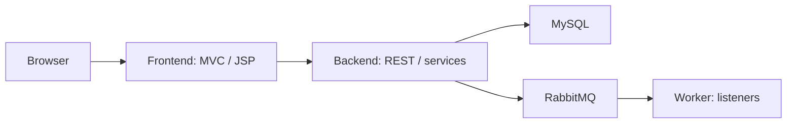

# Potential changes to align with `guideline.md`

## Executive summary

The current guideline applies to the backend, frontend and worker and requires Java 21 or later, Spring Boot 4.2.x on JDK 21 or 25, coding and security practices, at least 75% unit-test line coverage per Java project, and merge-blocking browser tests for web applications; it recommends Azure Application Insights.[^1] All three application repositories currently specify Java 8 and Spring Boot 2.7.18, and their tracked trees have no test sources or repository CI workflows; external pipelines and deployed configuration were not examined.[^2][^3][^4]

The highest-value changes are to remove committed credentials and unsafe logging, establish test and CI gates, upgrade the build and runtime stacks, and correct validation and misleading failure handling. Order messaging and the incomplete approval flow need particular attention, but their delivery guarantees and authorization requirements require explicit decisions. The November 25 Fusion assessment predates the framework requirement and should not be used as the current policy on framework versions.[^5]

## Scope and evidence

This assessment compares the current Fusion guideline with the default-branch source snapshots below. It is a static analysis, not a deployment audit or a measured coverage report.

| Repository | Reviewed commit | Role |
|---|---|---|
| [luxu-ms/SupplyChain-Docs-Fusion](https://github.com/luxu-ms/SupplyChain-Docs-Fusion) | `468e4ce85b8186591ce180eb1ee61d0ae02ed68f` | Guideline and previous assessment |
| [luxu-ms/SupplyChain-Backend](https://github.com/luxu-ms/SupplyChain-Backend) | `a21f57e84901bad3cf315de2a3520fa8fe34b911` | Orders, persistence and message publisher |
| [luxu-ms/SupplyChain-Frontend](https://github.com/luxu-ms/SupplyChain-Frontend) | `c613adbc961e0499d8f2ddb3e087ade7a9a40881` | Spring MVC/JSP web application |
| [luxu-ms/SupplyChain-Worker](https://github.com/luxu-ms/SupplyChain-Worker) | `458f2bab94b08b3acd167feb04fc485a7ecf6133` | RabbitMQ message listeners |

The frontend calls the backend, which persists orders and attempts to publish messages consumed by the worker.[^6][^7][^8]

## Recommended changes

### 1. Secrets, logs and deployment configuration

**Observed:** Backend configuration contains literal database and broker credentials; worker configuration also contains literal broker credentials. The worker logs full message bodies, and the backend logs an approval identifier. Whether those values are used in deployed environments, or whether the payloads contain sensitive data, is unknown.[^9][^10][^11][^12]

**Potential changes:**

- Remove literal credentials from tracked configuration, use approved secret storage and least-privilege accounts, and assess exposure and rotation. Review repository history and deployment use before deciding the appropriate response.
- Avoid logging full payloads or personal identifiers; retain safe event identifiers and useful error context. Externalize deployment-specific endpoints and review database transport and SQL logging configuration.[^9][^13]
- Verify Application Insights instrumentation, configuration and safe telemetry in each deployed application. This is a **should** in the guideline, not an unconditional must; the repository snapshots alone cannot establish whether an agent is already deployed.[^1]

### 2. Platform and dependency migration

**Observed:** All three POMs declare Java 8 and Spring Boot 2.7.18; Dockerfiles build with tests skipped and use Java 8 runtime environments. The frontend is a WAR using Tomcat/Jasper and legacy servlet/JSTL dependencies; backend entities import `javax.persistence`.[^2][^3][^4][^14][^15][^16][^17]

**Potential changes:**

- Set Maven compiler `release` to a supported version, using JDK 21 or 25 with Spring Boot 4.2.x, and align local development, CI build images and production runtimes. Update each POM and Dockerfile together.[^1]
- Plan and verify Jakarta migration, compatible persistence/driver versions and the frontend's servlet container, JSP and JSTL combination. Preserve the existing WAR/JSP approach unless an independently justified change is chosen; the guideline does not require replacing it.[^1][^16][^17]
- Verify AMQP dependencies, message serialization and compatibility between producer and consumer across rollout versions. The current backend converter and worker string listener are concrete integration points, not proof that the upgraded combination will work.[^18][^8]

### 3. Unit tests, coverage and browser CI

**Observed:** The researchers inspected complete, non-truncated tracked trees and found no test sources or repository CI workflows in the three application snapshots. That does not prove that external CI is absent, nor does it establish a measured coverage percentage. The Docker builds skip tests.[^14][^15]

**Potential changes:**

- Add deterministic JUnit 5 unit tests for business rules, boundary conditions and failure handling, with mocked external dependencies and regression tests for fixes. Configure JaCoCo or an equivalent to fail CI if **production-code line coverage from unit tests is below 75% in any Java project**. Keep integration and browser execution data separate; do not exclude business logic just to pass.[^19]
- Add pull-request browser tests for dashboard loading, valid order submission, validation feedback and appearance in the pending list; include inventory browsing and approval when those flows are available, plus important failure paths. Use isolated data, stable selectors, condition-based waits, visible assertions and retained traces or screenshots.[^20]
- Ensure the coverage and browser jobs actually run without skip flags and that repository rules or branch protection make the relevant checks required. Whether such protection already exists is unverified.

### 4. Backend validation, money and error handling

**Observed:** The order API binds a persistence entity directly, and the service dereferences the monetary amount before validating it and compares it through `doubleValue()`. The entity already uses `BigDecimal`. A vendor rating service catches broad exceptions and returns `0.0`, which its controller returns as a successful response.[^21][^22][^23]

**Potential changes:**

- Introduce a restricted, validated request DTO; validate required fields, amount precision and size at the boundary, and keep the active-vendor business rule in the service. Decide explicit client-visible error mappings and which status/approval fields clients can set.[^21][^22]
- Compare money with `BigDecimal.ZERO` after null validation. Define whether excess fractional precision is rejected or rounded and specify a rounding mode if rounding is allowed; do not silently change the financial contract.[^22][^23]
- Replace success-shaped fallback values for unexpected failures with explicit, appropriately translated errors; use targeted exception handling and preserve causes. Convert field injection of required collaborators to constructor injection and final fields.[^24][^25]

### 5. Messaging and worker behavior

**Observed:** Order creation saves the entity and attempts publication within a database transaction, catches publication failures and returns the order; inventory publishing similarly suppresses failures. The worker's listeners log and sleep rather than actually deliver notifications, catch broad exceptions, and log message bodies. Actual container acknowledgment, retry and broker configuration are not established by this static review.[^7][^8][^26]

**Potential changes:**

- Define the contract for publication failures and surface unexpected failures rather than silently presenting unqualified success. Decide the required relationship between transaction commit and event delivery; if reliable asynchronous delivery is required, a transactional outbox with retry and idempotent consumers is a candidate, not a guideline-mandated design.[^1][^7]
- Implement the intended processing or clearly expose its simulated nature; handle only recoverable exceptions, preserve interruption where applicable and verify retry, acknowledgment and dead-letter behavior in the actual deployment.[^8]
- Add focused producer/consumer contract and serialization regression tests, then verify broker behavior separately. An earlier assessment reported a focused timestamp-conversion reproduction, not an end-to-end deployment test.[^18][^27]

### 6. Frontend behavior and UI boundaries

**Observed:** The order form POST binds a DTO without server-side validation in the controller, while the DTO includes server-managed fields. The dashboard renders zeros when its data fetch fails. The pending page exposes an approval link, but the reviewed frontend controller has no matching handler; the backend exposes a PUT approval endpoint.[^28][^29][^30][^31]

**Potential changes:**

- Add a restricted form model, server-side validation and user-visible field errors; preserve entered values on failure and obtain valid vendors rather than relying on hardcoded choices.[^28][^32]
- Replace fabricated zero counts and conflicting error/empty states with clear unavailable/error states and safe messages. Use constructor injection and move dashboard business rules out of the controller.[^29][^33]
- Resolve the incomplete approval journey by implementing the appropriate frontend-to-backend interaction after defining authorization and approval semantics, or otherwise removing/disable the misleading control. Once available, cover the actual user-visible approval flow in browser CI.[^30][^31][^20]

### 7. Documentation and governance

- Fix the guideline's relative `architecture.md` link, which does not resolve in the pinned Fusion tree, and link to an authoritative current architecture document.[^34]
- Update the older Fusion gap assessment or mark its policy conclusions as superseded: its statement that no framework version is mandated predates the current Spring Boot requirement.[^5][^1]
- Clarify operational ambiguities: ownership and exceptions, coverage aggregation details, and when conditional UI flows count as available. These are suggested clarifications, not additional existing requirements.

## Suggested sequencing and acceptance criteria

1. **Contain immediate exposure:** externalize credentials, assess rotation and sanitize logs; verify actual deployment use before claiming exposure or successful remediation.
2. **Build a safety net:** create deterministic unit and browser regression coverage, measure a baseline, and configure required CI checks. The final gate must enforce at least 75% unit-only production line coverage independently for each Java project, and required browser checks for the web application.[^19][^20]
3. **Correct business and failure behavior:** address request validation, money comparisons, misleading fallbacks and order/worker failure semantics; agree on financial and delivery contracts before changing them.
4. **Upgrade and verify together:** migrate JDK, Spring Boot, dependencies and runtime images; exercise the deployed WAR, persistence and producer/consumer compatibility in an isolated environment.
5. **Verify operations:** assess Application Insights, secrets, broker retry/dead-letter behavior and required branch checks in the real deployment. Repair documentation and record any approved exceptions.

This sequence is a recommendation, not a prescribed ordering in the guideline; incremental safety and migration work can proceed together as dependencies permit.

## Confidence assessment

**High:** The quoted requirements, pinned POMs, Dockerfiles and cited source behavior are directly inspectable at the listed commits. The conclusion that the tracked trees lack tests and CI workflows is based on complete repository tree inspection, not on code-search absence.

**Limited:** No build, test suite, live database/broker, deployment, external CI, branch protection, secret store or telemetry configuration was exercised. The state of coverage, effective acknowledgment/retry behavior, deployed secrets and monitoring therefore remains unknown. The assessment assumes the Fusion guideline governs all three linked applications, as its introduction and prior assessment indicate.[^1][^5] Fusion lexical search was indexed at the older `3e81b3187da918290bd8b378c39bdfd6942e9ca2`; direct reads pinned to current commit `468e4ce85b8186591ce180eb1ee61d0ae02ed68f` were used instead. Some native search results were incomplete, so absence findings rely on tree inspection.

## Footnotes

[^1]: [Fusion guideline.md:1-19,33-35](https://github.com/luxu-ms/SupplyChain-Docs-Fusion/blob/468e4ce85b8186591ce180eb1ee61d0ae02ed68f/guideline.md#L1-L35).
[^2]: [Backend pom.xml:16-28](https://github.com/luxu-ms/SupplyChain-Backend/blob/a21f57e84901bad3cf315de2a3520fa8fe34b911/pom.xml#L16-L28).
[^3]: [Frontend pom.xml:16-28](https://github.com/luxu-ms/SupplyChain-Frontend/blob/c613adbc961e0499d8f2ddb3e087ade7a9a40881/pom.xml#L16-L28).
[^4]: [Worker pom.xml:16-28](https://github.com/luxu-ms/SupplyChain-Worker/blob/458f2bab94b08b3acd167feb04fc485a7ecf6133/pom.xml#L16-L28).
[^5]: [Fusion gaps-2026-11-25.md:7-16,31-37](https://github.com/luxu-ms/SupplyChain-Docs-Fusion/blob/468e4ce85b8186591ce180eb1ee61d0ae02ed68f/gaps-2026-11-25.md#L7-L37).
[^6]: [Frontend BackendApiService.java:21-39](https://github.com/luxu-ms/SupplyChain-Frontend/blob/c613adbc961e0499d8f2ddb3e087ade7a9a40881/src/main/java/com/acme/scm/frontend/service/BackendApiService.java#L21-L39).
[^7]: [Backend PurchaseOrderService.java:36-61](https://github.com/luxu-ms/SupplyChain-Backend/blob/a21f57e84901bad3cf315de2a3520fa8fe34b911/src/main/java/com/acme/scm/service/PurchaseOrderService.java#L36-L61).
[^8]: [Worker OrderMessageListener.java:16-57](https://github.com/luxu-ms/SupplyChain-Worker/blob/458f2bab94b08b3acd167feb04fc485a7ecf6133/src/main/java/com/acme/scm/worker/listener/OrderMessageListener.java#L16-L57).
[^9]: [Backend application.yml:8-31](https://github.com/luxu-ms/SupplyChain-Backend/blob/a21f57e84901bad3cf315de2a3520fa8fe34b911/src/main/resources/application.yml#L8-L31).
[^10]: [Worker application.yml:8-13](https://github.com/luxu-ms/SupplyChain-Worker/blob/458f2bab94b08b3acd167feb04fc485a7ecf6133/src/main/resources/application.yml#L8-L13).
[^11]: [Worker OrderMessageListener.java:16-19,31-34,45-48](https://github.com/luxu-ms/SupplyChain-Worker/blob/458f2bab94b08b3acd167feb04fc485a7ecf6133/src/main/java/com/acme/scm/worker/listener/OrderMessageListener.java#L16-L48).
[^12]: [Backend PurchaseOrderController.java:50-56](https://github.com/luxu-ms/SupplyChain-Backend/blob/a21f57e84901bad3cf315de2a3520fa8fe34b911/src/main/java/com/acme/scm/controller/PurchaseOrderController.java#L50-L56).
[^13]: [Backend VendorService.java:46-53](https://github.com/luxu-ms/SupplyChain-Backend/blob/a21f57e84901bad3cf315de2a3520fa8fe34b911/src/main/java/com/acme/scm/service/VendorService.java#L46-L53); [Frontend application.yml:14-22](https://github.com/luxu-ms/SupplyChain-Frontend/blob/c613adbc961e0499d8f2ddb3e087ade7a9a40881/src/main/resources/application.yml#L14-L22).
[^14]: [Backend Dockerfile:6-24](https://github.com/luxu-ms/SupplyChain-Backend/blob/a21f57e84901bad3cf315de2a3520fa8fe34b911/Dockerfile#L6-L24); [Worker Dockerfile:2-18](https://github.com/luxu-ms/SupplyChain-Worker/blob/458f2bab94b08b3acd167feb04fc485a7ecf6133/Dockerfile#L2-L18).
[^15]: [Frontend Dockerfile:2-22](https://github.com/luxu-ms/SupplyChain-Frontend/blob/c613adbc961e0499d8f2ddb3e087ade7a9a40881/Dockerfile#L2-L22).
[^16]: [Frontend pom.xml:8-11,37-55](https://github.com/luxu-ms/SupplyChain-Frontend/blob/c613adbc961e0499d8f2ddb3e087ade7a9a40881/pom.xml#L8-L55); [Frontend orders/new.jsp:1-2](https://github.com/luxu-ms/SupplyChain-Frontend/blob/c613adbc961e0499d8f2ddb3e087ade7a9a40881/src/main/webapp/WEB-INF/jsp/orders/new.jsp#L1-L2).
[^17]: [Backend PurchaseOrder.java:3-20](https://github.com/luxu-ms/SupplyChain-Backend/blob/a21f57e84901bad3cf315de2a3520fa8fe34b911/src/main/java/com/acme/scm/model/PurchaseOrder.java#L3-L20).
[^18]: [Backend AppConfig.java:58-68](https://github.com/luxu-ms/SupplyChain-Backend/blob/a21f57e84901bad3cf315de2a3520fa8fe34b911/src/main/java/com/acme/scm/config/AppConfig.java#L58-L68).
[^19]: [Fusion guideline.md:21-25](https://github.com/luxu-ms/SupplyChain-Docs-Fusion/blob/468e4ce85b8186591ce180eb1ee61d0ae02ed68f/guideline.md#L21-L25).
[^20]: [Fusion guideline.md:27-31](https://github.com/luxu-ms/SupplyChain-Docs-Fusion/blob/468e4ce85b8186591ce180eb1ee61d0ae02ed68f/guideline.md#L27-L31).
[^21]: [Backend PurchaseOrderController.java:43-56](https://github.com/luxu-ms/SupplyChain-Backend/blob/a21f57e84901bad3cf315de2a3520fa8fe34b911/src/main/java/com/acme/scm/controller/PurchaseOrderController.java#L43-L56).
[^22]: [Backend PurchaseOrderService.java:36-48](https://github.com/luxu-ms/SupplyChain-Backend/blob/a21f57e84901bad3cf315de2a3520fa8fe34b911/src/main/java/com/acme/scm/service/PurchaseOrderService.java#L36-L48).
[^23]: [Backend PurchaseOrder.java:22-48](https://github.com/luxu-ms/SupplyChain-Backend/blob/a21f57e84901bad3cf315de2a3520fa8fe34b911/src/main/java/com/acme/scm/model/PurchaseOrder.java#L22-L48).
[^24]: [Backend VendorService.java:46-58](https://github.com/luxu-ms/SupplyChain-Backend/blob/a21f57e84901bad3cf315de2a3520fa8fe34b911/src/main/java/com/acme/scm/service/VendorService.java#L46-L58); [Backend VendorController.java:32-36](https://github.com/luxu-ms/SupplyChain-Backend/blob/a21f57e84901bad3cf315de2a3520fa8fe34b911/src/main/java/com/acme/scm/controller/VendorController.java#L32-L36).
[^25]: [Backend PurchaseOrderService.java:20-34](https://github.com/luxu-ms/SupplyChain-Backend/blob/a21f57e84901bad3cf315de2a3520fa8fe34b911/src/main/java/com/acme/scm/service/PurchaseOrderService.java#L20-L34); [Frontend HomeController.java:21-47](https://github.com/luxu-ms/SupplyChain-Frontend/blob/c613adbc961e0499d8f2ddb3e087ade7a9a40881/src/main/java/com/acme/scm/frontend/controller/HomeController.java#L21-L47).
[^26]: [Backend InventoryService.java:47-61](https://github.com/luxu-ms/SupplyChain-Backend/blob/a21f57e84901bad3cf315de2a3520fa8fe34b911/src/main/java/com/acme/scm/service/InventoryService.java#L47-L61).
[^27]: [Fusion research.md:116-120](https://github.com/luxu-ms/SupplyChain-Docs-Fusion/blob/468e4ce85b8186591ce180eb1ee61d0ae02ed68f/research.md#L116-L120).
[^28]: [Frontend OrderController.java:58-69](https://github.com/luxu-ms/SupplyChain-Frontend/blob/c613adbc961e0499d8f2ddb3e087ade7a9a40881/src/main/java/com/acme/scm/frontend/controller/OrderController.java#L58-L69); [Frontend PurchaseOrderDTO.java:7-20](https://github.com/luxu-ms/SupplyChain-Frontend/blob/c613adbc961e0499d8f2ddb3e087ade7a9a40881/src/main/java/com/acme/scm/frontend/dto/PurchaseOrderDTO.java#L7-L20).
[^29]: [Frontend HomeController.java:54-60](https://github.com/luxu-ms/SupplyChain-Frontend/blob/c613adbc961e0499d8f2ddb3e087ade7a9a40881/src/main/java/com/acme/scm/frontend/controller/HomeController.java#L54-L60); [Frontend home.jsp:183-207](https://github.com/luxu-ms/SupplyChain-Frontend/blob/c613adbc961e0499d8f2ddb3e087ade7a9a40881/src/main/webapp/WEB-INF/jsp/home.jsp#L183-L207).
[^30]: [Frontend pending.jsp:73-83](https://github.com/luxu-ms/SupplyChain-Frontend/blob/c613adbc961e0499d8f2ddb3e087ade7a9a40881/src/main/webapp/WEB-INF/jsp/orders/pending.jsp#L73-L83); [Frontend OrderController.java:13-71](https://github.com/luxu-ms/SupplyChain-Frontend/blob/c613adbc961e0499d8f2ddb3e087ade7a9a40881/src/main/java/com/acme/scm/frontend/controller/OrderController.java#L13-L71).
[^31]: [Backend PurchaseOrderController.java:50-56](https://github.com/luxu-ms/SupplyChain-Backend/blob/a21f57e84901bad3cf315de2a3520fa8fe34b911/src/main/java/com/acme/scm/controller/PurchaseOrderController.java#L50-L56).
[^32]: [Frontend orders/new.jsp:54-89](https://github.com/luxu-ms/SupplyChain-Frontend/blob/c613adbc961e0499d8f2ddb3e087ade7a9a40881/src/main/webapp/WEB-INF/jsp/orders/new.jsp#L54-L89).
[^33]: [Frontend OrderController.java:25-30](https://github.com/luxu-ms/SupplyChain-Frontend/blob/c613adbc961e0499d8f2ddb3e087ade7a9a40881/src/main/java/com/acme/scm/frontend/controller/OrderController.java#L25-L30); [Frontend orders/list.jsp:195-202,231-239](https://github.com/luxu-ms/SupplyChain-Frontend/blob/c613adbc961e0499d8f2ddb3e087ade7a9a40881/src/main/webapp/WEB-INF/jsp/orders/list.jsp#L195-L239).
[^34]: [Fusion guideline.md:3](https://github.com/luxu-ms/SupplyChain-Docs-Fusion/blob/468e4ce85b8186591ce180eb1ee61d0ae02ed68f/guideline.md#L3); [Fusion gaps-2026-11-25.md:70-72](https://github.com/luxu-ms/SupplyChain-Docs-Fusion/blob/468e4ce85b8186591ce180eb1ee61d0ae02ed68f/gaps-2026-11-25.md#L70-L72).
