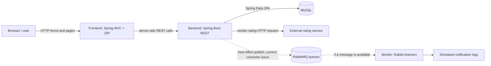

# SupplyChain architecture and typical workflow

## Executive summary

The system consists of a server-rendered Spring MVC/JSP frontend, a Spring Boot REST backend backed by MySQL, and a RabbitMQ worker intended to process asynchronous notifications. The normal user workflow is to review dashboards and stock, create a purchase order, and inspect pending orders; approval exists in the backend API but the frontend approval link has no corresponding handler.[^frontend-routes][^backend-orders][^approval-gap]

The worker's three listeners simulate notifications rather than sending them, and the backend does not currently wire up producers for all of those listeners.[^worker-listener][^inventory-service][^backend-approval] More importantly, the checked-in message converter is expected to reject the timestamps on ordinary new orders, so a valid order can be saved without its notification being published.[^converter-config][^converter-source][^entity-order][^backend-create] The assessment is based on pinned source and a focused converter reproduction, not a running end-to-end deployment.

## Repositories and scope

| Repository | Role | Examined `main` commit |
|---|---|---|
| [luxu-ms/SupplyChain-Frontend](https://github.com/luxu-ms/SupplyChain-Frontend) | JSP UI and server-side HTTP client | `c613adbc961e0499d8f2ddb3e087ade7a9a40881` |
| [luxu-ms/SupplyChain-Backend](https://github.com/luxu-ms/SupplyChain-Backend) | REST APIs, persistence and message publishing | `a21f57e84901bad3cf315de2a3520fa8fe34b911` |
| [luxu-ms/SupplyChain-Worker](https://github.com/luxu-ms/SupplyChain-Worker) | RabbitMQ listeners | `458f2bab94b08b3acd167feb04fc485a7ecf6133` |
| [luxu-ms/SupplyChain-Docs](https://github.com/luxu-ms/SupplyChain-Docs) | Supporting architecture and workflow notes | `580f5203ad332d9b5807f4aa26674fe85ff6c8a9` |
| [luxu-ms/SupplyChain-Docs-Fusion](https://github.com/luxu-ms/SupplyChain-Docs-Fusion) | Supplied documentation repository; its pinned tree contains only a blank README | `e4acaf3c53e7e69d5ce1c52bc871fbdc0539dc61` |

The request's `supplaychain-backend` is interpreted as **SupplyChain-Backend**; the typo-named repository was not found. The separate Docs repository describes it as a spelling variant.[^docs-typo][^fusion] Lexical and semantic searches for the three application repositories reported indexed commits matching the application SHAs above; these are source snapshots, not evidence of what is deployed.

## Architecture overview



Solid arrows represent implemented call paths; dashed arrows represent the attempted or conditional asynchronous path, not verified delivery.[^frontend-client][^backend-create][^converter-source][^worker-listener] The backend declares durable `order.created`, `inventory.alert`, and `approval.pending` queues. Its application config uses a JSON message converter; worker listeners take strings and do not parse typed event contracts.[^queue-config][^backend-settings][^worker-listener] Scheduling is enabled on the worker, but no scheduled method was found in the pinned worker tree.[^worker-main]

## Components

### Frontend

The frontend is a Java 8 / Spring Boot 2.7.18 WAR, using Spring MVC controllers, JSP and JSTL rather than a browser SPA. Controllers place backend results into the request model; a shared `RestTemplate` performs server-side calls. Its default backend base URL is `http://backend:8080/api`.[^frontend-pom][^frontend-entry][^frontend-views][^frontend-client]

| Page | Behavior |
|---|---|
| `/` | Fetches pending orders, low-stock items, vendors and all orders to calculate dashboard counts. An exception in this process resets all four counts to zero, which can hide an outage.[^dashboard] |
| `/orders` and `/orders/pending` | List all or pending orders. The pending page presents an approval link, but the frontend has no handler for it.[^frontend-orders][^approval-gap] |
| `/orders/new` | Form for order number, vendor ID, amount, requester and description; POST submits to the backend and redirects to the order list on success. Vendor choices are hardcoded examples, not fetched from the vendor API.[^order-form][^frontend-orders][^frontend-client] |
| `/inventory` | Displays inventory and identifies stock at or below safety stock.[^frontend-inventory] |
| `/vendors` | Displays vendors, contacts, scores and status; the reviewed page has no vendor-edit action.[^frontend-vendors] |

No authentication or authorization implementation was identified in the inspected frontend repository; an entry-point comment mentioning session authentication is not proof of an implemented security system.[^frontend-entry]

### Backend

The backend is a Java 8 / Spring Boot 2.7.18 application organized as REST controllers → services → Spring Data JPA repositories. It uses MySQL for orders, inventory and vendors, RabbitMQ for attempted asynchronous messages, and an external HTTP vendor-rating service.[^backend-pom][^backend-orders][^backend-create][^backend-repository][^backend-settings][^vendor-rating]

| API | Function |
|---|---|
| `GET /api/orders`, `GET /api/orders/{orderNumber}`, `GET /api/orders/pending` | List or retrieve orders.[^backend-orders] |
| `POST /api/orders` | Create an order. The controller returns 200 on success; service checks positive amount and an existing active vendor.[^backend-orders][^backend-create] |
| `PUT /api/orders/{orderNumber}/approve?approvedBy=...` | Approve a pending order, recording approver and date.[^backend-orders][^backend-approval] |
| `GET /api/inventory`, `GET /api/inventory/{sku}`, `GET /api/inventory/low-stock` | Read stock; low stock means quantity is less than or equal to safety stock.[^inventory-api][^inventory-service] |
| `GET /api/vendors`, `GET /api/vendors/{vendorCode}`, `GET /api/vendors/{vendorCode}/rating` | Read vendors and retrieve an external rating. The rating service returns `0.0` on null or exception, masking the distinction between failure and a zero rating.[^vendor-api][^vendor-rating] |

#### Data contracts

These are Java entity fields, not a claim that all JPA constraints are enforced as request-validation rules. Each entity has a generated `Long` ID.[^entity-order][^entity-inventory][^entity-vendor]

| Entity | Fields and behavior |
|---|---|
| `PurchaseOrder` | `id: Long`, `orderNumber: String`, `vendorId: Long`, `totalAmount: BigDecimal`, `status: OrderStatus`, `requestedBy`, `approvedBy`, `description: String`, `requestedDate`, `approvedDate`, `createdAt`, `updatedAt: LocalDateTime`. Status values: `PENDING`, `APPROVED`, `REJECTED`, `COMPLETED`, `CANCELLED`. On persist, timestamps are assigned and **only a null status** defaults to `PENDING`; an incoming non-null status is not forced to pending.[^entity-order] |
| `Inventory` | `id: Long`, `sku`, `productName`, `warehouseLocation`, `batchNumber: String`, `quantity`, `safetyStock: Integer`, `lastUpdated: LocalDateTime`. `isLowStock()` is `quantity <= safetyStock`.[^entity-inventory] |
| `Vendor` | `id: Long`, `vendorCode`, `name`, `contactPerson`, `email`, `phone`, `address: String`, `performanceScore: BigDecimal`, `status: VendorStatus`, `createdAt: LocalDateTime`. Status values are `ACTIVE`, `INACTIVE`, `BLACKLISTED`; on persist null status defaults to `ACTIVE` and null score to 100.[^entity-vendor] |

The frontend purchase-order DTO adds `vendorName`, omits backend `updatedAt`, and models status as a string; the order client posts the DTO directly.[^frontend-dto][^frontend-client] For example, an illustrative minimal backend request is:

```http
POST /api/orders
Content-Type: application/json

{
  "orderNumber": "PO-2026-001",
  "vendorId": 1,
  "totalAmount": 15000.00,
  "requestedBy": "john.doe",
  "description": "Office supplies"
}
```

This assumes vendor `1` already exists and is active. The example is illustrative, not a captured request or response.[^backend-create][^order-form]

### Worker

The worker is a Java 8 / Spring Boot application that connects to RabbitMQ and listens on the three configured queues. Each handler logs the supplied string, sleeps briefly, then logs a success message. There is no actual email delivery in those handlers.[^worker-pom][^worker-settings][^worker-listener]

For example, the order handler contains:

```java
// Simulate processing
Thread.sleep(1000);
log.info("✅ Order notification email sent successfully");
```

This is simulation code, not proof of an email being sent.[^worker-listener] The handlers catch and log exceptions without rethrowing them; caught processing failures therefore do not signal failure to the listener container. No explicit retry, dead-letter, acknowledgement or idempotency policy was found in the checked-in worker configuration. Conversion or container failures outside the handler need separate runtime investigation.[^worker-listener][^worker-settings]

## Typical workflow

1. **Review current state.** The browser opens the dashboard or inventory/vendor pages. The frontend calls backend REST endpoints, and the backend reads MySQL through JPA. Low stock is calculated by comparing quantity with safety stock.[^dashboard][^frontend-inventory][^inventory-service]
2. **Create an order.** The user opens `/orders/new`, selects one of the hardcoded vendor IDs, and submits the form. The frontend binds a DTO, posts it to `/api/orders`, and redirects to `/orders` on success; on an exception it redisplays the form with an error.[^order-form][^frontend-orders][^frontend-client]
3. **Validate and save.** The backend requires a positive amount and an existing active vendor, then saves the entity in a transaction. For a normal new order with no status, the entity callback sets `PENDING` and the timestamps. Null amount is dereferenced rather than explicitly validated.[^backend-create][^entity-order]
4. **Attempt notification.** After saving and before transaction commit, the backend calls `rabbitTemplate.convertAndSend(orderCreatedQueue, savedOrder)` and catches publishing exceptions. It declares `order.created` as a durable queue; the two-argument send uses the default exchange with the queue name as routing key.[^backend-create][^queue-config][^rabbit-send] The checked-in converter issue described below prevents successful conversion for ordinary new orders; a database commit can still succeed because the exception is caught.
5. **Process a delivered message, if any.** If an order message reaches the queue, the worker logs it, waits, and logs simulated notification success. It does not actually send an email.[^worker-listener]
6. **Approve through the API.** The user can see pending orders, but the UI's approval link has no matching frontend route. A caller can instead invoke `PUT /api/orders/{orderNumber}/approve?approvedBy=...`; the backend requires `PENDING`, sets `APPROVED`, records approver and approval date, and saves. This path does not update inventory or publish an approval event in the reviewed service.[^approval-gap][^backend-orders][^backend-approval]

Inventory alert publishing exists as a backend helper, but the low-stock GET only reads items and no invocation or scheduler was found in the reviewed backend tree. Likewise, the `approval.pending` listener and queue exist, but no backend producer was found. Consequently neither should be represented as an automatic end-to-end workflow.[^inventory-service][^inventory-api][^backend-approval][^worker-listener]

## Messaging reliability and important gaps

- **Order serialization:** The backend installs a no-argument `Jackson2JsonMessageConverter`.[^converter-config] The Spring AMQP 2.4.17 implementation creates a plain `ObjectMapper`, without registering the Java time module.[^converter-source] A focused in-memory reproduction using the relevant AMQP/Jackson versions and a non-null `LocalDateTime` produced a `MessageConversionException`; registering `JavaTimeModule` made the reproduction serialize. Normal new orders have timestamps set by the entity lifecycle before the send attempt, so the checked-in configuration is expected to fail to publish these messages.[^entity-order][^persist-callback] This was **not** tested with a live database and broker.
- **Database/message consistency:** The conversion/publish exception is caught within the transaction. A successful commit can therefore leave a saved order without a notification; other database or commit failures can still fail the request. Sending before commit without an outbox also provides no demonstrated atomic database/message guarantee.[^backend-create]
- **Payload contract:** Backend publishes JSON-converted domain objects while the worker accepts strings and performs no domain validation. This difference alone does not establish a delivery failure; conversion and deployment overrides should be checked end to end.[^converter-config][^worker-listener]
- **Incomplete UI and automation:** The approval UI route is missing, the vendor selection is hardcoded, and actual notifications and automated low-stock/approval producers are not implemented in the reviewed paths.[^approval-gap][^order-form][^worker-listener][^inventory-service]

## Deployment and operations

Each application has a Dockerfile; no Compose or Kubernetes manifest was found in the reviewed pinned application trees. Docker builds skip tests. Backend defaults to port 8080, MySQL at `mysql:3306/supplychain`, and RabbitMQ at `rabbitmq:5672`; its Hibernate configuration uses `ddl-auto: update`.[^backend-docker][^backend-settings] The worker uses the same broker host and queue names. Although worker configuration sets port 8082, its build has no web starter, so an HTTP listener should not be assumed.[^worker-settings][^worker-pom][^worker-docker]

The frontend Dockerfile deploys its WAR to external Tomcat and exposes 8081, but does not configure Tomcat's connector; the `server.port` property is not evidence that an external Tomcat connector listens on 8081. Verify and configure the connector or container port mapping in the actual deployment.[^frontend-docker][^frontend-views] The configuration includes hardcoded credentials; supply secrets securely rather than relying on checked-in defaults.[^backend-settings][^worker-settings]

## Confidence assessment

**High:** Component responsibilities, code-level endpoints, entity fields, missing frontend approval handler, queue names and simulated worker behavior are directly supported by the pinned source. The converter failure is supported by a focused reproduction and framework-source trace, but not a full application run.

**Limits and assumptions:** The typo in the request was mapped to `SupplyChain-Backend`. Repository inspection and indexed searches describe accessible source only; they do not prove that no inaccessible repository, deployment override, external publisher, scheduled job, live authentication layer, or different deployed version exists. Broker delivery, database commit, runtime port mapping, exact wire serialization and end-to-end user behavior were not tested. No tracked tests were found in the reviewed application trees.

## Footnotes

[^docs-typo]: [SupplyChain-Docs/research.md:119-123](https://github.com/luxu-ms/SupplyChain-Docs/blob/580f5203ad332d9b5807f4aa26674fe85ff6c8a9/research.md#L119-L123).
[^fusion]: [SupplyChain-Docs-Fusion/README.md:1](https://github.com/luxu-ms/SupplyChain-Docs-Fusion/blob/e4acaf3c53e7e69d5ce1c52bc871fbdc0539dc61/README.md#L1).
[^frontend-pom]: [SupplyChain-Frontend/pom.xml:10-69](https://github.com/luxu-ms/SupplyChain-Frontend/blob/c613adbc961e0499d8f2ddb3e087ade7a9a40881/pom.xml#L10-L69).
[^frontend-entry]: [SupplyChain-Frontend/src/main/java/com/acme/scm/frontend/SupplyChainFrontendApplication.java:7-27](https://github.com/luxu-ms/SupplyChain-Frontend/blob/c613adbc961e0499d8f2ddb3e087ade7a9a40881/src/main/java/com/acme/scm/frontend/SupplyChainFrontendApplication.java#L7-L27).
[^frontend-views]: [SupplyChain-Frontend/src/main/resources/application.yml:1-18](https://github.com/luxu-ms/SupplyChain-Frontend/blob/c613adbc961e0499d8f2ddb3e087ade7a9a40881/src/main/resources/application.yml#L1-L18).
[^frontend-client]: [SupplyChain-Frontend/src/main/java/com/acme/scm/frontend/service/BackendApiService.java:23-65](https://github.com/luxu-ms/SupplyChain-Frontend/blob/c613adbc961e0499d8f2ddb3e087ade7a9a40881/src/main/java/com/acme/scm/frontend/service/BackendApiService.java#L23-L65); [src/main/java/com/acme/scm/frontend/config/AppConfig.java:11-22](https://github.com/luxu-ms/SupplyChain-Frontend/blob/c613adbc961e0499d8f2ddb3e087ade7a9a40881/src/main/java/com/acme/scm/frontend/config/AppConfig.java#L11-L22).
[^dashboard]: [SupplyChain-Frontend/src/main/java/com/acme/scm/frontend/controller/HomeController.java:30-63](https://github.com/luxu-ms/SupplyChain-Frontend/blob/c613adbc961e0499d8f2ddb3e087ade7a9a40881/src/main/java/com/acme/scm/frontend/controller/HomeController.java#L30-L63).
[^frontend-routes]: [SupplyChain-Frontend/src/main/java/com/acme/scm/frontend/controller/OrderController.java:13-71](https://github.com/luxu-ms/SupplyChain-Frontend/blob/c613adbc961e0499d8f2ddb3e087ade7a9a40881/src/main/java/com/acme/scm/frontend/controller/OrderController.java#L13-L71).
[^frontend-orders]: [SupplyChain-Frontend/src/main/java/com/acme/scm/frontend/controller/OrderController.java:21-71](https://github.com/luxu-ms/SupplyChain-Frontend/blob/c613adbc961e0499d8f2ddb3e087ade7a9a40881/src/main/java/com/acme/scm/frontend/controller/OrderController.java#L21-L71).
[^approval-gap]: [SupplyChain-Frontend/src/main/webapp/WEB-INF/jsp/orders/pending.jsp:74-83](https://github.com/luxu-ms/SupplyChain-Frontend/blob/c613adbc961e0499d8f2ddb3e087ade7a9a40881/src/main/webapp/WEB-INF/jsp/orders/pending.jsp#L74-L83); [src/main/java/com/acme/scm/frontend/controller/OrderController.java:13-71](https://github.com/luxu-ms/SupplyChain-Frontend/blob/c613adbc961e0499d8f2ddb3e087ade7a9a40881/src/main/java/com/acme/scm/frontend/controller/OrderController.java#L13-L71).
[^order-form]: [SupplyChain-Frontend/src/main/webapp/WEB-INF/jsp/orders/new.jsp:58-101](https://github.com/luxu-ms/SupplyChain-Frontend/blob/c613adbc961e0499d8f2ddb3e087ade7a9a40881/src/main/webapp/WEB-INF/jsp/orders/new.jsp#L58-L101).
[^frontend-inventory]: [SupplyChain-Frontend/src/main/java/com/acme/scm/frontend/controller/InventoryController.java:19-31](https://github.com/luxu-ms/SupplyChain-Frontend/blob/c613adbc961e0499d8f2ddb3e087ade7a9a40881/src/main/java/com/acme/scm/frontend/controller/InventoryController.java#L19-L31); [src/main/webapp/WEB-INF/jsp/inventory.jsp:52-96](https://github.com/luxu-ms/SupplyChain-Frontend/blob/c613adbc961e0499d8f2ddb3e087ade7a9a40881/src/main/webapp/WEB-INF/jsp/inventory.jsp#L52-L96).
[^frontend-vendors]: [SupplyChain-Frontend/src/main/java/com/acme/scm/frontend/controller/VendorController.java:19-30](https://github.com/luxu-ms/SupplyChain-Frontend/blob/c613adbc961e0499d8f2ddb3e087ade7a9a40881/src/main/java/com/acme/scm/frontend/controller/VendorController.java#L19-L30); [src/main/webapp/WEB-INF/jsp/vendors.jsp:61-103](https://github.com/luxu-ms/SupplyChain-Frontend/blob/c613adbc961e0499d8f2ddb3e087ade7a9a40881/src/main/webapp/WEB-INF/jsp/vendors.jsp#L61-L103).
[^frontend-dto]: [SupplyChain-Frontend/src/main/java/com/acme/scm/frontend/dto/PurchaseOrderDTO.java:7-20](https://github.com/luxu-ms/SupplyChain-Frontend/blob/c613adbc961e0499d8f2ddb3e087ade7a9a40881/src/main/java/com/acme/scm/frontend/dto/PurchaseOrderDTO.java#L7-L20).
[^backend-pom]: [SupplyChain-Backend/pom.xml:16-54](https://github.com/luxu-ms/SupplyChain-Backend/blob/a21f57e84901bad3cf315de2a3520fa8fe34b911/pom.xml#L16-L54).
[^backend-orders]: [SupplyChain-Backend/src/main/java/com/acme/scm/controller/PurchaseOrderController.java:18-57](https://github.com/luxu-ms/SupplyChain-Backend/blob/a21f57e84901bad3cf315de2a3520fa8fe34b911/src/main/java/com/acme/scm/controller/PurchaseOrderController.java#L18-L57).
[^backend-repository]: [SupplyChain-Backend/src/main/java/com/acme/scm/repository/PurchaseOrderRepository.java:10-19](https://github.com/luxu-ms/SupplyChain-Backend/blob/a21f57e84901bad3cf315de2a3520fa8fe34b911/src/main/java/com/acme/scm/repository/PurchaseOrderRepository.java#L10-L19).
[^backend-create]: [SupplyChain-Backend/src/main/java/com/acme/scm/service/PurchaseOrderService.java:36-61](https://github.com/luxu-ms/SupplyChain-Backend/blob/a21f57e84901bad3cf315de2a3520fa8fe34b911/src/main/java/com/acme/scm/service/PurchaseOrderService.java#L36-L61).
[^backend-approval]: [SupplyChain-Backend/src/main/java/com/acme/scm/service/PurchaseOrderService.java:73-90](https://github.com/luxu-ms/SupplyChain-Backend/blob/a21f57e84901bad3cf315de2a3520fa8fe34b911/src/main/java/com/acme/scm/service/PurchaseOrderService.java#L73-L90).
[^inventory-api]: [SupplyChain-Backend/src/main/java/com/acme/scm/controller/InventoryController.java:13-36](https://github.com/luxu-ms/SupplyChain-Backend/blob/a21f57e84901bad3cf315de2a3520fa8fe34b911/src/main/java/com/acme/scm/controller/InventoryController.java#L13-L36).
[^inventory-service]: [SupplyChain-Backend/src/main/java/com/acme/scm/service/InventoryService.java:32-63](https://github.com/luxu-ms/SupplyChain-Backend/blob/a21f57e84901bad3cf315de2a3520fa8fe34b911/src/main/java/com/acme/scm/service/InventoryService.java#L32-L63).
[^vendor-api]: [SupplyChain-Backend/src/main/java/com/acme/scm/controller/VendorController.java:13-36](https://github.com/luxu-ms/SupplyChain-Backend/blob/a21f57e84901bad3cf315de2a3520fa8fe34b911/src/main/java/com/acme/scm/controller/VendorController.java#L13-L36).
[^vendor-rating]: [SupplyChain-Backend/src/main/java/com/acme/scm/service/VendorService.java:42-57](https://github.com/luxu-ms/SupplyChain-Backend/blob/a21f57e84901bad3cf315de2a3520fa8fe34b911/src/main/java/com/acme/scm/service/VendorService.java#L42-L57).
[^entity-order]: [SupplyChain-Backend/src/main/java/com/acme/scm/model/PurchaseOrder.java:14-76](https://github.com/luxu-ms/SupplyChain-Backend/blob/a21f57e84901bad3cf315de2a3520fa8fe34b911/src/main/java/com/acme/scm/model/PurchaseOrder.java#L14-L76).
[^entity-inventory]: [SupplyChain-Backend/src/main/java/com/acme/scm/model/Inventory.java:13-50](https://github.com/luxu-ms/SupplyChain-Backend/blob/a21f57e84901bad3cf315de2a3520fa8fe34b911/src/main/java/com/acme/scm/model/Inventory.java#L13-L50).
[^entity-vendor]: [SupplyChain-Backend/src/main/java/com/acme/scm/model/Vendor.java:14-65](https://github.com/luxu-ms/SupplyChain-Backend/blob/a21f57e84901bad3cf315de2a3520fa8fe34b911/src/main/java/com/acme/scm/model/Vendor.java#L14-L65).
[^backend-settings]: [SupplyChain-Backend/src/main/resources/application.yml:1-44](https://github.com/luxu-ms/SupplyChain-Backend/blob/a21f57e84901bad3cf315de2a3520fa8fe34b911/src/main/resources/application.yml#L1-L44).
[^queue-config]: [SupplyChain-Backend/src/main/java/com/acme/scm/config/AppConfig.java:43-67](https://github.com/luxu-ms/SupplyChain-Backend/blob/a21f57e84901bad3cf315de2a3520fa8fe34b911/src/main/java/com/acme/scm/config/AppConfig.java#L43-L67).
[^converter-config]: [SupplyChain-Backend/src/main/java/com/acme/scm/config/AppConfig.java:58-68](https://github.com/luxu-ms/SupplyChain-Backend/blob/a21f57e84901bad3cf315de2a3520fa8fe34b911/src/main/java/com/acme/scm/config/AppConfig.java#L58-L68).
[^converter-source]: [spring-projects/spring-amqp, v2.4.17, spring-amqp/src/main/java/org/springframework/amqp/support/converter/Jackson2JsonMessageConverter.java:40-60](https://github.com/spring-projects/spring-amqp/blob/v2.4.17/spring-amqp/src/main/java/org/springframework/amqp/support/converter/Jackson2JsonMessageConverter.java#L40-L60); [spring-projects/spring-boot, v2.7.18, spring-boot-project/spring-boot-dependencies/build.gradle:1713-1725](https://github.com/spring-projects/spring-boot/blob/v2.7.18/spring-boot-project/spring-boot-dependencies/build.gradle#L1713-L1725).
[^persist-callback]: [spring-projects/spring-data-jpa, 2.7.18, src/main/java/org/springframework/data/jpa/repository/support/SimpleJpaRepository.java:659-670](https://github.com/spring-projects/spring-data-jpa/blob/2.7.18/src/main/java/org/springframework/data/jpa/repository/support/SimpleJpaRepository.java#L659-L670); [hibernate/hibernate-orm, 5.6.15, hibernate-core/src/main/java/org/hibernate/event/internal/AbstractSaveEventListener.java:103-114](https://github.com/hibernate/hibernate-orm/blob/5.6.15/hibernate-core/src/main/java/org/hibernate/event/internal/AbstractSaveEventListener.java#L103-L114).
[^rabbit-send]: [spring-projects/spring-amqp, v2.4.17, spring-rabbit/src/main/java/org/springframework/amqp/rabbit/core/RabbitTemplate.java:1147-1149](https://github.com/spring-projects/spring-amqp/blob/v2.4.17/spring-rabbit/src/main/java/org/springframework/amqp/rabbit/core/RabbitTemplate.java#L1147-L1149).
[^worker-main]: [SupplyChain-Worker/src/main/java/com/acme/scm/worker/SupplyChainWorkerApplication.java:16-25](https://github.com/luxu-ms/SupplyChain-Worker/blob/458f2bab94b08b3acd167feb04fc485a7ecf6133/src/main/java/com/acme/scm/worker/SupplyChainWorkerApplication.java#L16-L25).
[^worker-pom]: [SupplyChain-Worker/pom.xml:16-55](https://github.com/luxu-ms/SupplyChain-Worker/blob/458f2bab94b08b3acd167feb04fc485a7ecf6133/pom.xml#L16-L55).
[^worker-settings]: [SupplyChain-Worker/src/main/resources/application.yml:1-25](https://github.com/luxu-ms/SupplyChain-Worker/blob/458f2bab94b08b3acd167feb04fc485a7ecf6133/src/main/resources/application.yml#L1-L25).
[^worker-listener]: [SupplyChain-Worker/src/main/java/com/acme/scm/worker/listener/OrderMessageListener.java:16-57](https://github.com/luxu-ms/SupplyChain-Worker/blob/458f2bab94b08b3acd167feb04fc485a7ecf6133/src/main/java/com/acme/scm/worker/listener/OrderMessageListener.java#L16-L57).
[^backend-docker]: [SupplyChain-Backend/Dockerfile:6-24](https://github.com/luxu-ms/SupplyChain-Backend/blob/a21f57e84901bad3cf315de2a3520fa8fe34b911/Dockerfile#L6-L24).
[^frontend-docker]: [SupplyChain-Frontend/Dockerfile:9-22](https://github.com/luxu-ms/SupplyChain-Frontend/blob/c613adbc961e0499d8f2ddb3e087ade7a9a40881/Dockerfile#L9-L22).
[^worker-docker]: [SupplyChain-Worker/Dockerfile:1-18](https://github.com/luxu-ms/SupplyChain-Worker/blob/458f2bab94b08b3acd167feb04fc485a7ecf6133/Dockerfile#L1-L18).
